# Week 09 - 동아리 멤버 관리 API 

**Render Deployment URL:** [https://wsd-assign09-c01-22200619.onrender.com](https://wsd-assign09-c01-22200619.onrender.com)
**멤버 조회 API:** [GET /api/members](https://wsd-assign09-c01-22200619.onrender.com/api/members)
**GitHub Repository:** [SungyulLim/WSD_assign09-c01-22200619](https://github.com/SungyulLim/WSD_assign09-c01-22200619)

## 1. 프로젝트 소개
### 주제 및 주요 기능
- 동아리 멤버의 이름, 학번, 학과, 학년, 이메일, 직책을 관리하는 Spring Boot REST API이다.

- 멤버 등록, 전체 조회, 단건 조회, 정보 수정, 삭제
- MariaDB의 `members` 테이블과 JPA entity 연결

### Entity 필드 구조
id를 제외한 필드는 6개. 

| Java 필드 | 타입 | DB 컬럼 | 의미 |
|---|---|---|---|
| id | Long | id | 멤버 고유 번호 |
| name | String | name | 이름 |
| studentId | String | student_id | 학번 |
| department | String | department | 학과 |
| grade | Integer | grade | 학년 |
| email | String | email | 이메일 |
| role | String | role | 동아리 직책 |

### 프로젝트 구조
```text
week09_jpa_project/
├── Dockerfile
├── build.gradle
├── settings.gradle
├── gradlew / gradlew.bat
├── gradle/wrapper/
├── src/main/java/com/webservice/
│   ├── Week09JpaProjectApplication.java
│   ├── controller/MemberController.java
│   ├── dto/MemberRequest.java
│   ├── dto/MemberResponse.java
│   ├── entity/Member.java
│   ├── repository/MemberRepository.java
│   └── service/MemberService.java
├── src/main/resources/application.properties
├── src/test/java/com/webservice/Week09JpaProjectApplicationTests.java
├── sql실습/
└── README.md
```

### 개발환경

| 항목 | 사용 환경 |
|---|---|
| 언어 | Java|
| 프레임워크 | Spring Boot|
| 빌드 | Gradle|
| 주요 의존성 | Spring Web MVC, Spring Data JPA, Validation, MariaDB Driver |
| DB / DB 도구 | MariaDB / DBeaver |
| IDE | IntelliJ IDEA |
| 배포 | Render Web Service, Docker |
| Docker Java 환경 | Eclipse Temurin 17 JDK / JRE |
| 로컬 기본 포트 | 8000 |

## 2. Database SQL Practice

- SQL 직접 실습용 테이블은 `movie_sql`, JPA 프로그램의 테이블은 `members`
### 기존 Table 조회 및 데이터 추가 결과 (table : books)
- 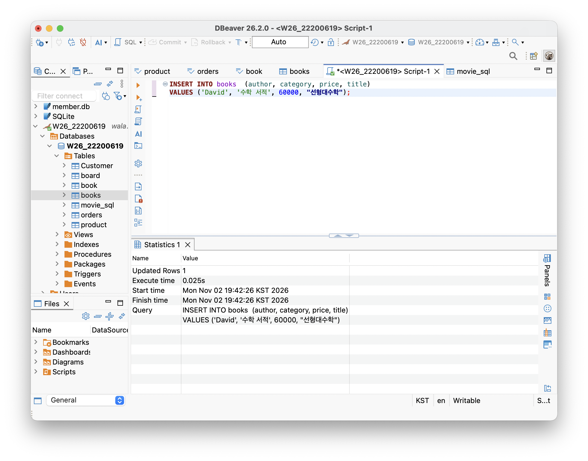
- 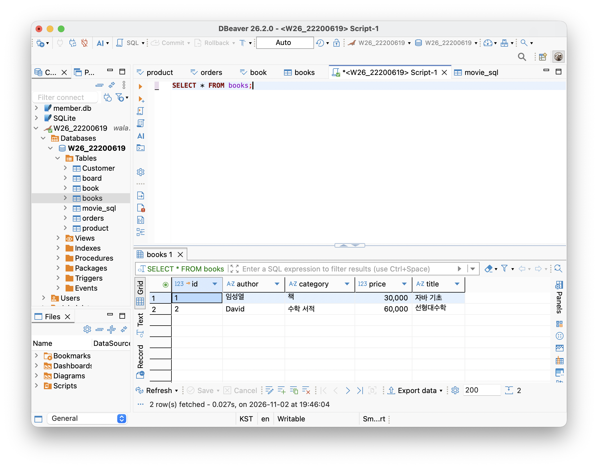

### 2.2 CREATE — 새 테이블 생성

```sql
CREATE TABLE movie_sql (
    id BIGINT AUTO_INCREMENT PRIMARY KEY,
    title VARCHAR(100) NOT NULL,
    director VARCHAR(100),
    genre VARCHAR(50),
    rating DOUBLE
);
```

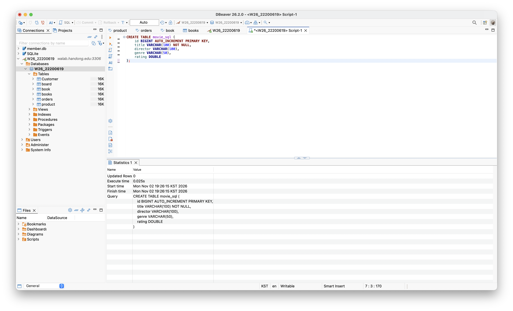
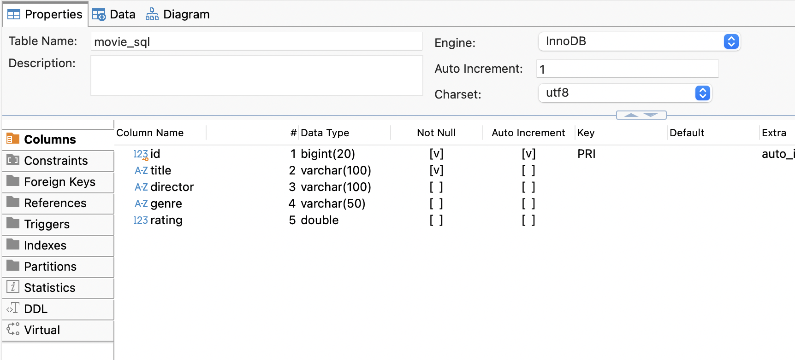

### 2.3 INSERT — 영화 3건 추가

```sql
INSERT INTO movie_sql(title, director, genre, rating)
VALUES ('Inception', 'Nolan', 'SF', 9.1),
       ('Interstellar', 'Nolan', 'SF', 9.3),
       ('Parasite', 'Bong', 'Drama', 9.0);
```
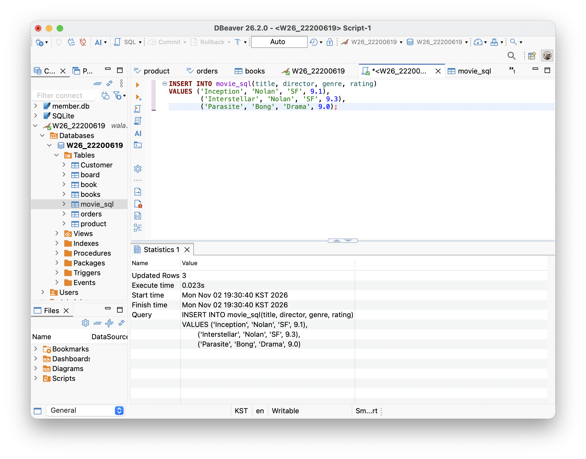
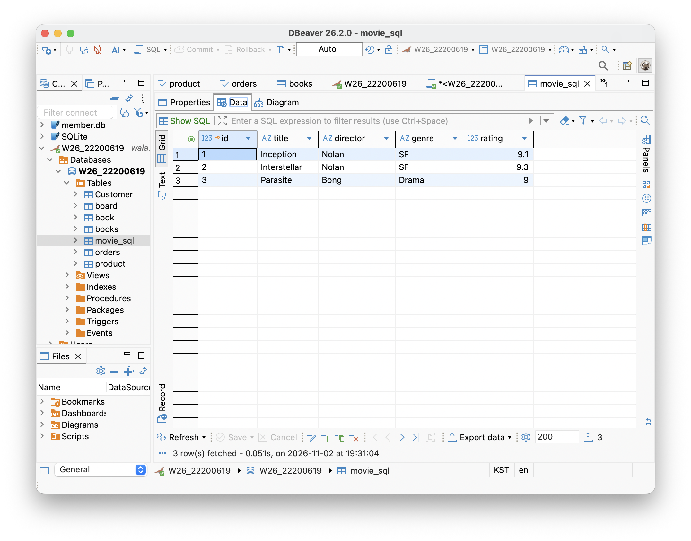


### 2.4 UPDATE — 평점 수정

```sql
UPDATE movie_sql
SET rating = 9.5
WHERE title = 'Interstellar';
```

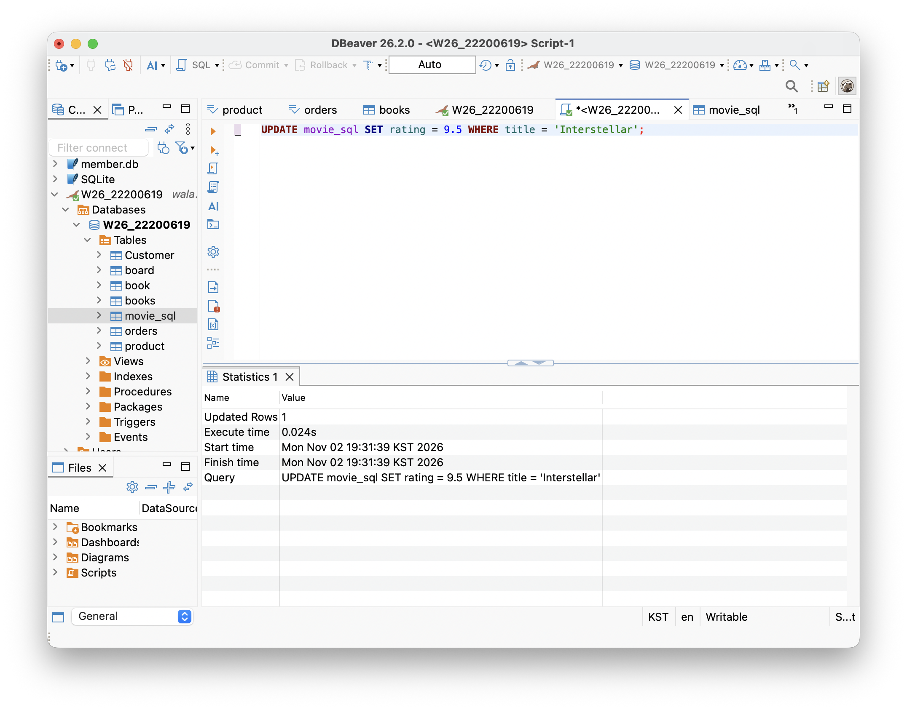
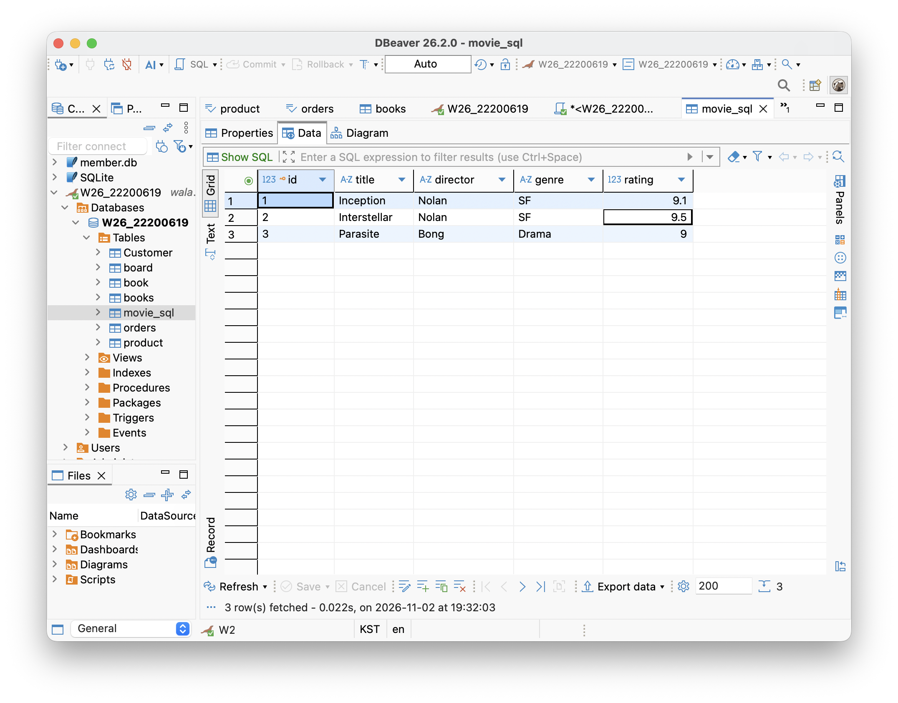

### 2.5 DELETE — 영화 삭제

```sql
DELETE FROM movie_sql WHERE title = 'Parasite';
```

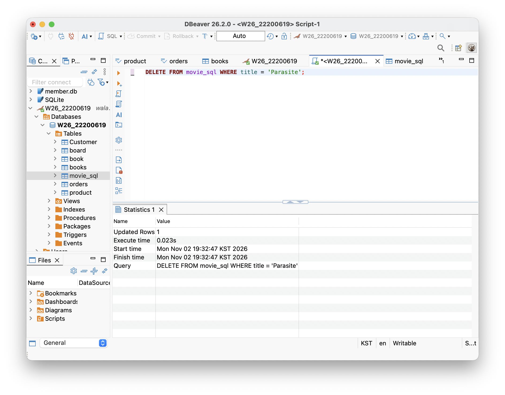
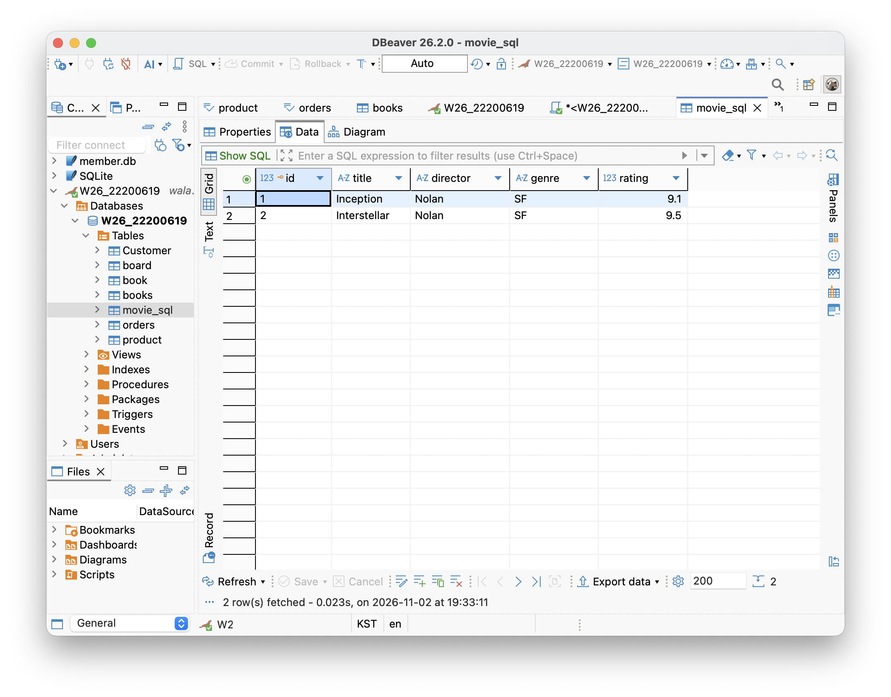

### 2.6 SELECT — 전체 및 일부 조회

```sql
SELECT * FROM movie_sql;

SELECT title, rating FROM movie_sql;

SELECT * FROM movie_sql WHERE genre = 'SF';
```

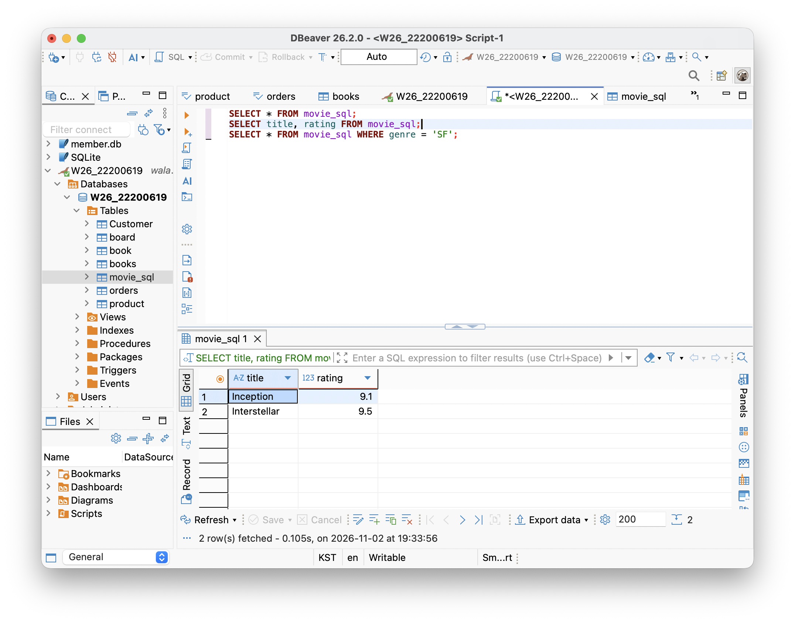

## 3. Spring Data JPA 구현
### 3.1 요청 처리 구조

```text
HTTP 요청 → MemberController → MemberService → MemberRepository → MariaDB
                  ↓                  ↓
            MemberRequest      MemberResponse
```

- Controller는 요청을 받고 HTTP 응답을 생성. 
- Service는 조회·등록·수정·삭제 과정을 처리.
- Repository는 JPA를 통해 `Member` 객체를 저장하거나 조회.

### 3.2 Entity와 Repository

- `Member`는 `@Entity`와 `@Table(name = "members")`로 DB 테이블에 연결. 
- JPA가 객체를 생성할 수 있도록 protected 기본 생성자를 두었고, 요청 DTO로 멤버를 생성하는 생성자와 수정용 `update()` 메서드를 작성.

```java
public interface MemberRepository extends JpaRepository<Member, Long> {}
```

### 3.3 사용한 Annotation

| Annotation | 프로젝트에서의 역할 |
|---|---|
| `@SpringBootApplication` | `com.webservice` 아래 애플리케이션 구성요소 탐색 및 실행 |
| `@Entity` | Member를 JPA 관리 대상으로 지정 |
| `@Table` | 테이블 이름을 members로 지정 |
| `@Id` | id를 기본키로 지정 |
| `@GeneratedValue(IDENTITY)` | DB 자동 증가 기능으로 id 생성 |
| `@Column` | 컬럼의 NULL 허용 여부와 문자열 길이 설정 |
| `@RestController`, `@RequestMapping` | 멤버 REST API와 기본 경로 지정 |
| `@PostMapping`, `@GetMapping`, `@PutMapping`, `@DeleteMapping` | HTTP 메서드별 처리 메서드 연결 |
| `@PathVariable`, `@RequestBody` | 경로의 id 및 JSON 요청 본문을 매개변수로 받음 |
| `@Valid` | 등록·수정 요청 DTO에 정의된 검증 실행 |
| `@NotBlank`, `@NotNull`, `@Size`, `@Email`, `@Min` | 필수값, 길이, 이메일 형식, 학년 검증 |
| `@Service` | 서비스 객체를 Spring 빈으로 등록 |

### 3.4 REST API Endpoint

| Method | Endpoint | 기능 |
|---|---|---|
| POST | `/api/members` | 등록 |
| GET | `/api/members` | 전체 조회 |
| GET | `/api/members/{id}` | 단건 조회 |
| PUT | `/api/members/{id}` | 전체 정보 수정 |
| DELETE | `/api/members/{id}` | 삭제 |

### 3.5 요청·응답 JSON 사용 예시

**등록 요청 — POST `/api/members`**

```json
{
  "name": "홍길동",
  "studentId": "20260001",
  "department": "컴퓨터공학과",
  "grade": 2,
  "email": "member@example.com",
  "role": "부원"
}
```
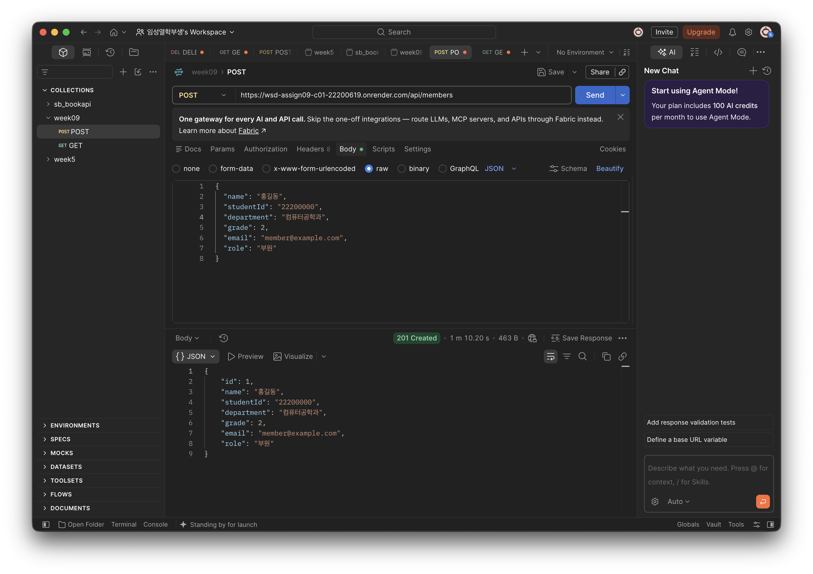
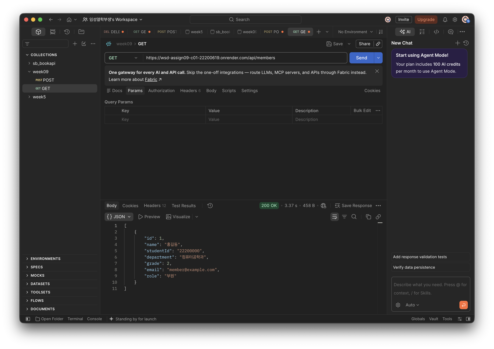

**GET — GET `/api/members`**


**수정 요청 — PUT `/api/members/1`**

```json
{
  "name": "홍길동",
  "studentId": "20260001",
  "department": "컴퓨터공학과",
  "grade": 3,
  "email": "member@example.com",
  "role": "총무"
}
```
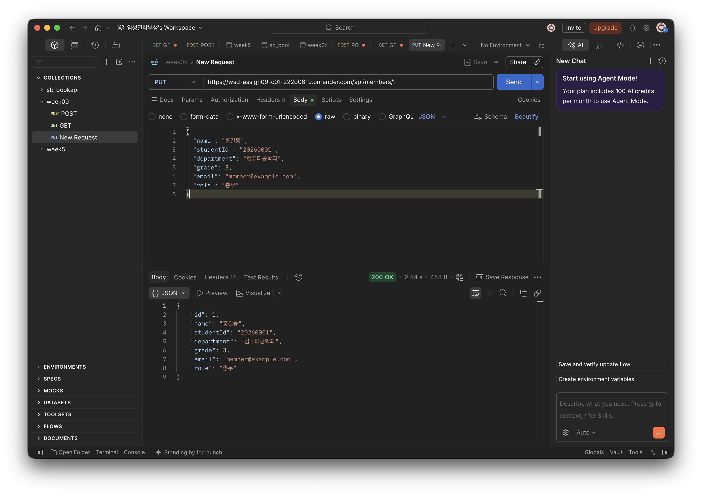`

### 3.6 JPA Entity와 실제 MariaDB Table 비교

// 해당 화면 수정

## 4. JPA와 SQL 비교

### 4.1 프로젝트에서 사용한 Repository 메서드 및 hibernate sql
1. save() — 등록 확인
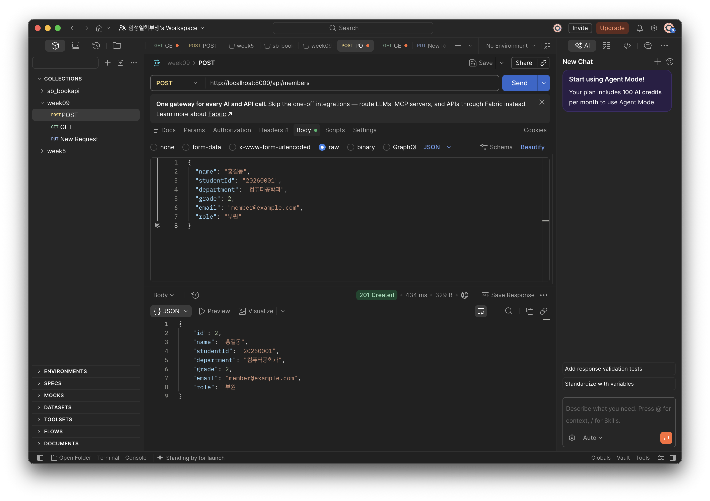
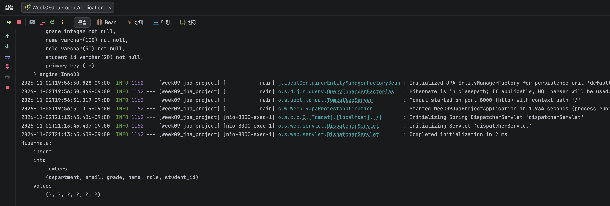

2. findAll() — 전체 조회 확인
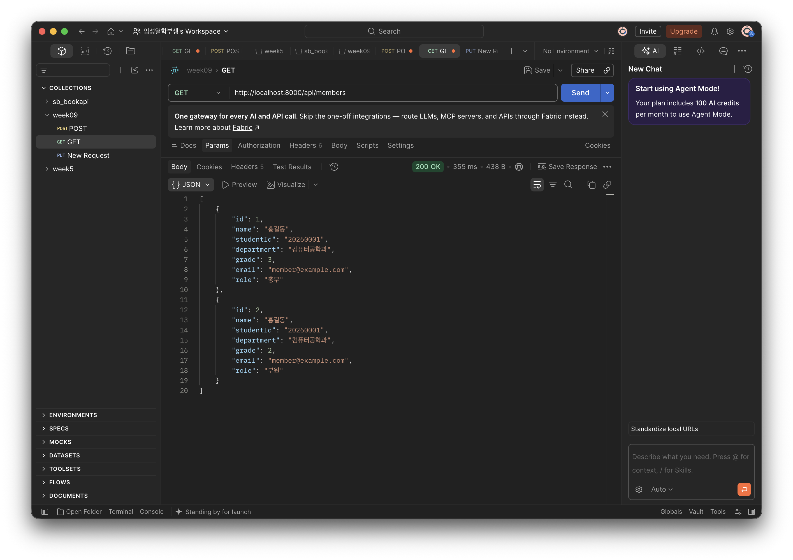
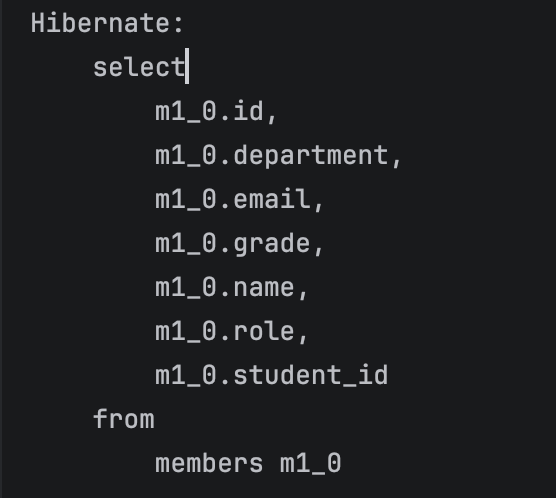

3. findById() — 단건 조회 확인
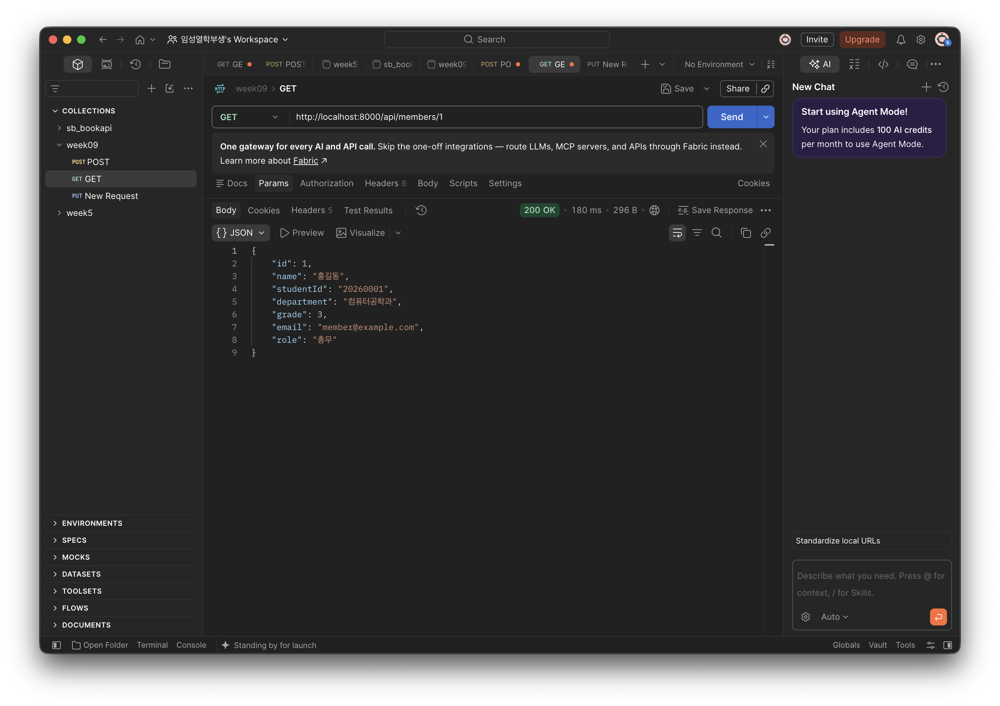
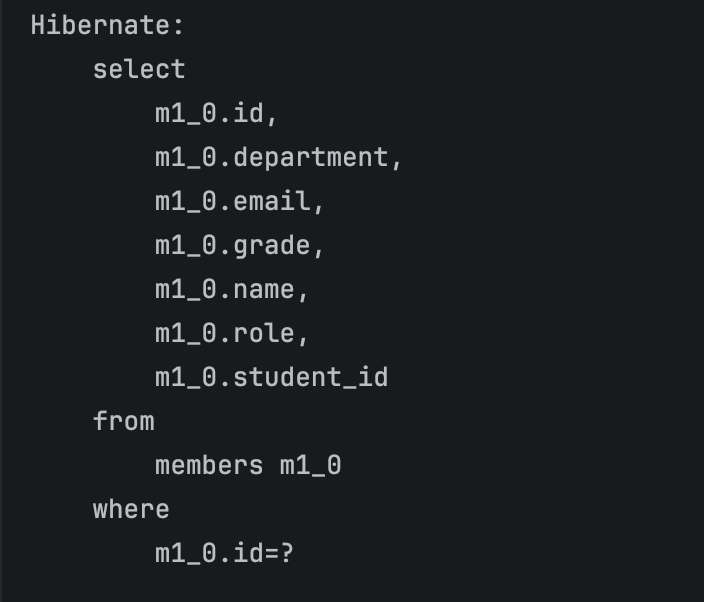

4. deleteById() — 삭제 확인
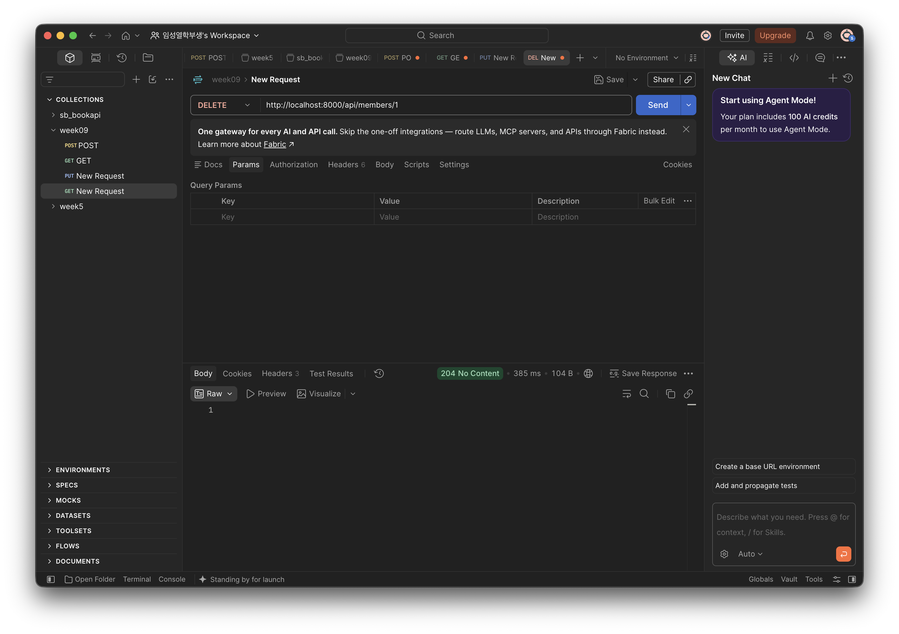
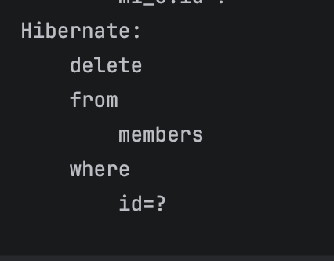


### 4.2 직접 SQL과 JPA 방식의 차이
SQL을 직접 작성하는 방식은 개발자가 `INSERT`, `SELECT`, `UPDATE`, `DELETE` 문으로 테이블과 처리 조건을 직접 작성하는 방식이고,
JPA 방식은 Java 객체와 Repository 메서드를 통해 데이터를 처리하는 방식이다. 
직접 SQL은 쿼리를 개발자가 직접 작성하기 때문에 각각의 쿼리문을 세부적으로 제어하기 쉽고, 
JPA는 반복적인 SQL 작성을 줄여 개발 편의성이 좋아진다. 

## 5. 배포 및 환경 설정

### 5.1 환경변수 설정

| 환경변수 | 용도 |
|---|---|
| `DB_URL` | MariaDB 연결 주소 |
| `DB_USERNAME` | DB 사용자 계정 |
| `DB_PASSWORD` | DB 비밀번호 |


- IntelliJ에서는 Run → Edit Configurations → Week09JpaProjectApplication → Environment variables에 DB 변수 3개를 등록한다.
- Render에서는 서비스의 Environment에서 DB 변수 3개를 등록한다.

### 5.2 Render 배포 과정

GitHub 저장소의 Dockerfile을 Render에서 빌드

1. 개인 GitHub 저장소를 Render Web Service와 연결.
2. 프로젝트 최상단의 `build.gradle`과 같은 위치에 `Dockerfile`을 추가하고 커밋했다.
4. Render의 Dockerfile Path는 `./Dockerfile`, 저장소 루트에서 빌드하는 경우 Root Directory는 비워 두도록 설정한다.
5. DB 환경변수 3개를 등록하고 Dockerfile이 포함된 최신 커밋으로 배포한다.


### 5.3 MariaDB 데이터 저장 확인
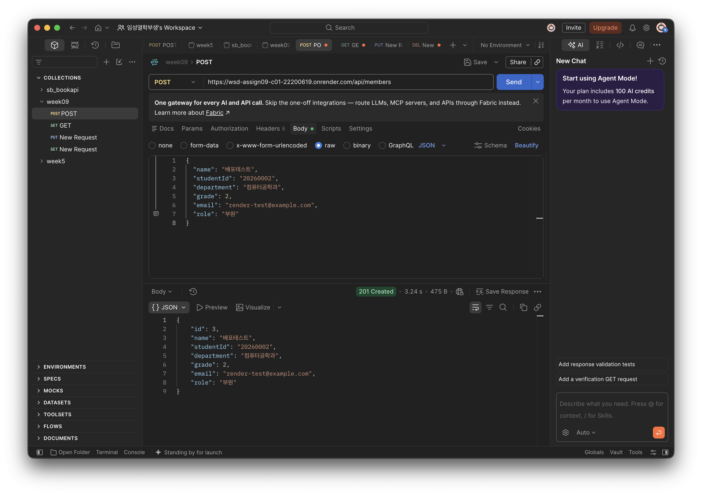
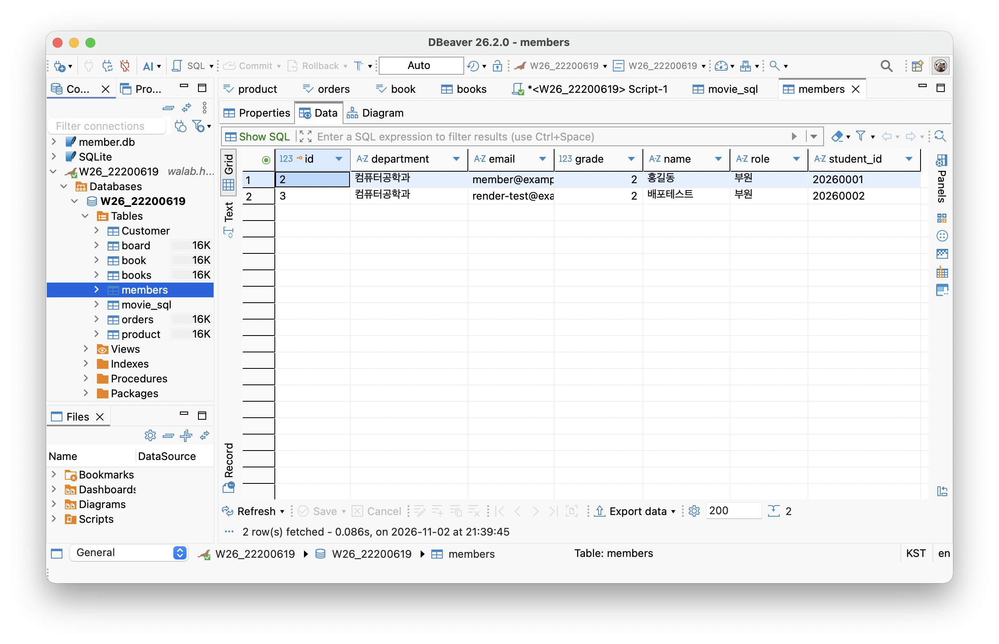

### 5.4 발생한 문제와 해결 과정

| 문제 | 원인 | 수행한 조치 및 확인 범위 |
|---|---|---|
| `package jakarta.validation.constraints does not exist` | 검증 라이브러리 누락 | validation starter 추가 후 compileJava 성공 확인 |
| `Could not find or load main class` | IntelliJ 실행 설정에 이전 패키지 경로가 남음 | Main class를 `com.webservice.Week09JpaProjectApplication`으로 수정 |
| Render의 Start Command Required | 생성 화면의 시작 명령 미입력, Java 프로젝트에 맞지 않는 설정 | Docker 방식으로 배포 설정 변경 |
| `unknown instruction: plugins` | build.gradle을 Dockerfile로 지정 | Dockerfile Path를 실제 Dockerfile 경로로 변경하도록 정리 |
| `open Dockerfile: no such file or directory` | 배포 커밋에 Dockerfile이 없음 | Dockerfile 추가 및 커밋 완료 |


## 6. Weekly Report

### Key Learning

1. **Entity와 테이블의 연결:** Member에 작성한 필드가 실제 members 테이블의 컬럼으로 나타나는 것을 확인했다. Java의 `studentId`가 DB에서는 `student_id`로 표시돼 코드와 DB의 이름을 비교하는 과정이 필요했다.
2. **SQL CRUD와 Repository의 연결:** 영화 테이블에서는 SQL을 직접 실행했고, 멤버 프로그램에서는 `save()`, `findAll()`, `findById()`, `deleteById()`를 사용하도록 구현했다. 두 방식의 처리 결과는 최종적으로 DB에서 확인해야 한다는 점을 배웠다.
3. **컴파일·실행·배포 설정의 구분:** validation 의존성 누락은 컴파일 문제였고, Main class 오류는 IDE 실행 설정 문제였으며, Dockerfile 오류는 배포 설정 문제였다. 오류가 발생한 단계를 먼저 구분해야 수정할 대상을 정확히 찾을 수 있었다.

### Problem & Solution
1.
DTO에서 `@NotBlank`, `@Email`, `@Min` 등을 사용했지만 Gradle에 validation starter가 없어 컴파일 오류가 발생했다. 
오류 메시지에서 `jakarta.validation.constraints` 패키지를 찾지 못한다는 내용을 확인하고, `spring-boot-starter-validation`을 추가했다. 
이후 성공 결과를 확인했다.

2.
컴파일 문제를 해결한 뒤에는 IntelliJ가 이전 패키지의 실행 클래스를 가리켜 애플리케이션을 시작하지 못했다. 
Main class를 현재 패키지인 `com.webservice`에 맞게 수정했고, 실행 후 DBeaver에서 `members` 테이블을 확인했다. 
Render에서는 배포 파일 경로와 파일 누락 문제를 확인해 Dockerfile을 추가했다.

### Code Review

```java
public MemberResponse update(Long id, MemberRequest request) {
    Member member = findEntity(id);
    member.update(request);
    return MemberResponse.from(repository.save(member));
}
```

`findEntity(id)`는 먼저 수정할 멤버를 조회하고, 없으면 404 예외를 발생시킨다. 
`member.update(request)`는 id를 유지한 채 6개 입력 필드를 변경한다. 
마지막으로 `repository.save(member)`를 명시적으로 호출하고 저장 결과를 Response DTO로 변환한다. 
새 멤버를 생성하는 등록 기능과 달리, 수정에서는 기존 id의 멤버를 조회하는 과정이 먼저 필요하다.

### AI Usage

- **본인이 생각하는 AI 사용률: 30%**
- **AI 활용 내용:** render에서 배포하는 과정에서 dockerFile이 인식되지 않는 문제를 해결하는 과정에서 해당 파일을 생성하는 과정에 사용. 컴파일 과정에서 인텔리제이가 이전 패키지의 실행 클래스를 가리키는 문제를 해결하는 방법을 AI에게 질문하여 해결함
- **직접 수행·검증한 내용:** 샘플 코드를 통해서 해당 코드를 구성하고, postman/DBeaver를 통해서 해당 코드 실행 테스트
- 
### Reflection
이번 과제를 통해 Hibernate가 Java 객체와 데이터베이스를 연결해 주는 과정과 그 장점을 알 수 있었다. 
처음에는 SQL을 직접 작성하는 방식이 더 익숙했지만, JPA의 save(), findAll(), findById(), deleteById()를 사용하면서 반복적인 SQL 작성을 줄일 수 있다는 점이 편리하게 느껴졌다. 
Entity에 필드와 테이블의 관계를 정의하면 객체를 중심으로 데이터를 다룰 수 있어 코드의 흐름도 이해하기 쉬웠다.